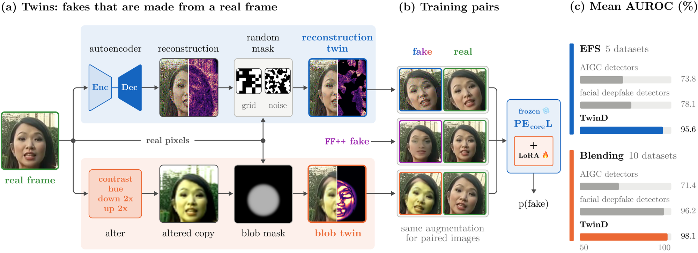

# TwinD: Generalizing Deepfake Detection from Blending to Entire Face Synthesis

[](https://arxiv.org/abs/2611.25935)
[](https://huggingface.co/yermandy/TwinD)
[](https://huggingface.co/datasets/yermandy/TwinD)



TwinD is a frame-level deepfake detector: [PE-Core-L](https://huggingface.co/timm/vit_pe_core_large_patch14_336.fb)
with LoRA and a linear classifier, trained on FaceForensics++ fakes and two kinds of *twins*, fakes made from a real
frame:

- **reconstruction twin**: the frame reconstructed by the CogVideoX autoencoder, with the real pixels put back inside
  a random grid or noise mask;
- **blob twin**: the frame blended with an altered copy of itself inside a soft round blob.

Each fake is paired with the real frame it was made from, and both get the same augmentation.

This repository is a full reproduction of TwinD: the code trains, soups and tests the model, and
[the training set](https://huggingface.co/datasets/yermandy/TwinD) holds exactly the same frames the paper's model was
trained on. [The released model](https://huggingface.co/yermandy/TwinD), a uniform soup of 3 seeds, is the TwinD
evaluated in the paper's tables. A model trained from scratch follows the same recipe; its AUROC varies with the
seeds, as any single training run.

## Install

```bash
uv sync && source .venv/bin/activate
```

## Test

```bash
python test.py --data example # downloads TwinD.safetensors from huggingface.co/yermandy/TwinD
```

`example/` has 4 face crops from each of 8 test videos: 2 real / fake pairs from Celeb-DF-v2 and 2 from DF26 (fakes of
Wan 2.2 and LTX 2.3, image-to-video):

```bash
example/
├── real/<video>/frame_XXXX.png
└── fake/<video>/frame_XXXX.png
```

The score of a video is the mean fake probability of its frames, and the metric is the video-level AUROC. In every
pair, the fake scores above its real video:

```bash
                                                         video  label  p_fake
                              example/fake/CDFv2--id0_id1_0001      1 0.68919
                            example/fake/CDFv2--id10_id11_0001      1 0.96754
example/fake/DF26--LTX_2.3_distilled_i2v--1wtzVjN_D84_4_0to241      1 0.50318
      example/fake/DF26--Wan_2.2_14b_i2v--0_97fDSpUnw_2_0to270      1 0.75523
                                  example/real/CDFv2--id0_0001      0 0.50796
                                 example/real/CDFv2--id10_0001      0 0.73234
                       example/real/DF26--0_97fDSpUnw_2_0to270      0 0.14141
                       example/real/DF26--1wtzVjN_D84_4_0to241      0 0.29698

Video-level AUROC: 81.2 % (8 videos)
```

The scores are ranked, not thresholded: AUROC needs no decision threshold. The paper uses up to 32 frames per video and
all test videos of each dataset.

### Your own videos

Crop the faces with `detector.py` (SCRFD-10GF, alignment on 5 keypoints, face box enlarged 1.3x, crop at about the
original face size), the preprocessing of every test dataset in the paper:

```bash
python detector.py -i videos/real -o my_test/real # up to 32 evenly spaced frames per video
python detector.py -i videos/fake -o my_test/fake
python test.py --data my_test
```

## Train

The training set is gated: accept its terms on [the dataset page](https://huggingface.co/datasets/yermandy/TwinD)
(access is granted at once) and log in with `hf auth login`.

```bash
python prepare_data.py # training set from huggingface.co/datasets/yermandy/TwinD
for seed in 1 2 3; do python train.py --seed $seed --out runs/seed$seed; done
python soup.py runs/seed{1,2,3}/TwinD.safetensors --out TwinD.safetensors
python test.py --data example --weights TwinD.safetensors
```

One run takes about an hour on an A100. The recipe: 10 epochs of 34,434 pairs in batches of 64 pairs, Adam at 3e-4
after a 1-epoch warm-up, bf16, L2-SP toward the initial weights instead of weight decay, and SWA over the epoch-end
weights of the last 5 epochs. Each LoRA update is folded into its weight before averaging, so `TwinD.safetensors` is
a plain PE-Core-L with a linear head.

### Other autoencoders

The training set also has the reconstructions of four other autoencoders (Tab. 3 of the paper):

```bash
python prepare_data.py --decoders kvae2d ltxvideo hunyuanvideo ltx2
python train.py --seed 1 --decoder ltx2 --out runs/ltx2-seed1
```

## Training set

[`yermandy/TwinD`](https://huggingface.co/datasets/yermandy/TwinD) holds the face crops as Parquet shards of at most
500 MB, `data/<dataset>/<method>/train-*.parquet`, one row per frame:

| column        | content                                                                        |
| ------------- | ------------------------------------------------------------------------------ |
| `image`       | the PNG bytes of the crop                                                      |
| `path`        | e.g. `FF-x1.3-th0.5-all-aligned/real/001/frame_0000.png`                       |
| `label`       | real / fake                                                                    |
| `dataset`     | `FF++` or `CCv2`                                                               |
| `method`      | `real`, `DF`, `F2F`, `FS`, `NT`, or the autoencoder of a reconstruction        |
| `video`       | the video of the frame                                                         |
| `paired_real` | `path` of the real frame a fake was made from, pixel-aligned with it           |

| dataset | method                                          | frames |
| ------- | ----------------------------------------------- | -----: |
| FF++    | real, 8 frames per training video               |  5,739 |
| FF++    | DF / F2F / FS / NT                              | 22,907 |
| FF++    | cogvideox / kvae2d / ltxvideo / hunyuanvideo / ltx2, each |  5,739 |
| CCv2    | real, 1 random frame per Casual Conversations v2 video |  1,913 |
| CCv2    | cogvideox / kvae2d / ltxvideo / hunyuanvideo / ltx2, each |  1,913 |

The blob twins and the masks of the reconstruction twins are made during training.

## Files

| file              | content                                                              |
| ----------------- | -------------------------------------------------------------------- |
| `model.py`        | PE-Core-L, LoRA, linear head                                         |
| `data.py`         | twins, augmentation, pairs and their sampler                         |
| `train.py`        | training of one seed                                                 |
| `soup.py`         | uniform soup of several seeds                                        |
| `test.py`         | video-level AUROC on face crops                                      |
| `prepare_data.py` | download and extraction of the training set                          |
| `detector.py`     | face crops of videos and images                                      |
| `scrfd.py`        | SCRFD-10GF face detector (InsightFace det_10g; weights from the Hub)  |

## License

The code is released under the [MIT License](LICENSE). Other parts keep the terms of their sources:

- `TwinD.safetensors` ([yermandy/TwinD](https://huggingface.co/yermandy/TwinD)): CC BY-NC 4.0, as it is trained on
  FaceForensics++ and Casual Conversations v2 (non-commercial research only). It is fine-tuned from PE-Core-L
  (Apache-2.0).
- `scrfd_10g.pth` ([yermandy/TwinD](https://huggingface.co/yermandy/TwinD)): converted from the InsightFace
  `buffalo_l` det_10g model, non-commercial research only.
- `example/`: frames of Celeb-DF-v2 and DF26 test videos, under the terms of these datasets.
- The training set ([yermandy/TwinD](https://huggingface.co/datasets/yermandy/TwinD)): the terms of FaceForensics++
  and Casual Conversations v2.

## Citation

```bibtex
@article{TwinD,
  title={{TwinD}: Generalizing Deepfake Detection from Blending to Entire Face Synthesis},
  author={Andrii Yermakov and Jan Cech and Mario Fritz and Jiri Matas},
  journal={arXiv preprint arXiv:2611.25935},
  year={2026},
}
```
